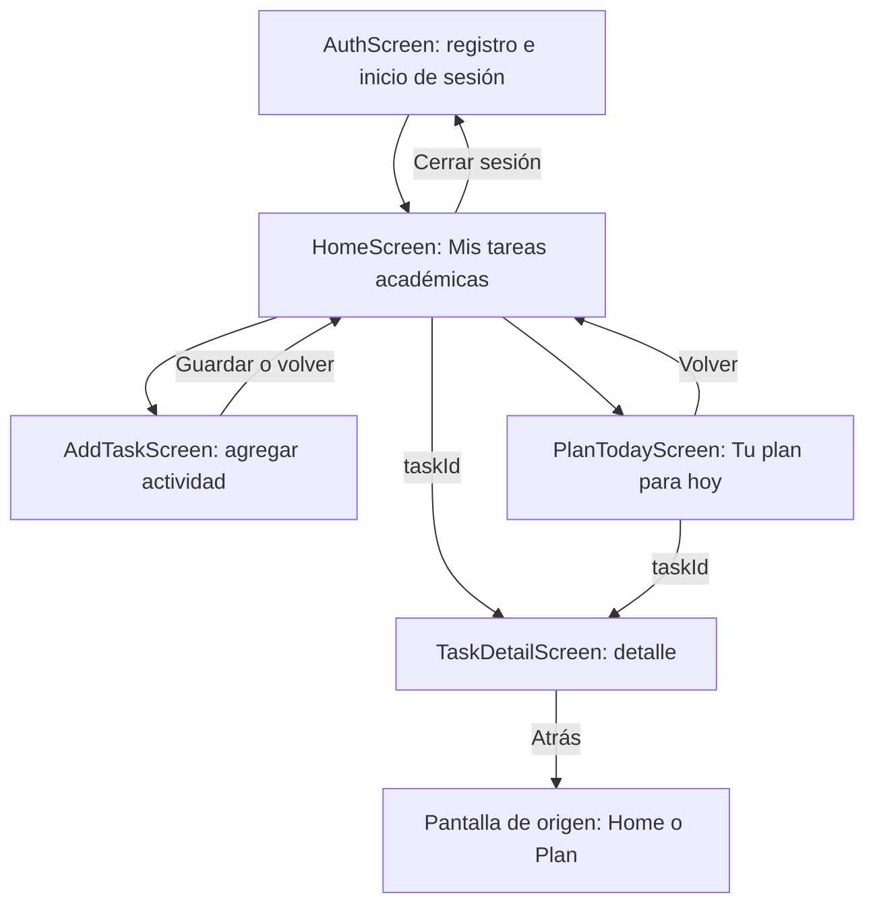
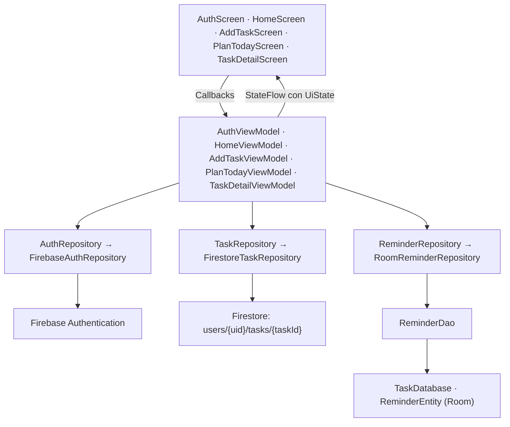

# TaskPrioritizer — GoGrin

Aplicación Android para organizar tareas académicas. Equipo: Santiago Estuardo Maldonado Garrido (25717), Gabriel Zambrano Garoz (25676) y Zabdi Soham Pelicó Hernández (25586).

## 1. Problema y solución

Los estudiantes universitarios con varias responsabilidades necesitan reunir sus tareas y decidir cuáles atender primero.
Las entrevistas identificaron dificultades para dar seguimiento a las actividades y planificar por prioridad.
TaskPrioritizer permite registrar fecha de entrega, prioridad y tiempo estimado, consultar las tareas y marcarlas como completadas.
El plan ordena las pendientes por prioridad y fecha; el tiempo lo introduce el usuario, no lo predice un modelo.

## 2. Cómo ejecutar

### Entorno utilizado

| Componente | Configuración |
| --- | --- |
| Android Studio | Quail 2, 2026.1.2; build AI-261.25134.95.2612.15822958 |
| Sistema de desarrollo comprobado | Windows 11 |
| JDK del daemon de Gradle | 21, según `gradle/gradle-daemon-jvm.properties` |
| Gradle Wrapper | 9.5.0 |
| Android Gradle Plugin | 9.3.2 |
| Android mínimo | API 26 (Android 8.0) |
| SDK de compilación | API 37, nivel menor 1, según `app/build.gradle.kts` |
| SDK objetivo | API 36 |
| Identificador de aplicación | `com.example.taskprioritizer` |

Las versiones se encuentran en [el catálogo de dependencias](gradle/libs.versions.toml), [el módulo app](app/build.gradle.kts) y [el Wrapper](gradle/wrapper/gradle-wrapper.properties). La compatibilidad de código Java se configura en 11; esto no sustituye el requisito de JDK 21 para el daemon.

### Clonar, abrir y ejecutar

1. Instalar Git y Android Studio con Android SDK y Platform Tools.
2. Clonar y seleccionar la rama de entrega:

   ```powershell
   git clone https://github.com/SohamHernandez26/TaskPrioritizer.git
   cd TaskPrioritizer
   git switch entrega-final
   ```

   Para reproducir una evaluación, utilizar el SHA indicado en la descripción del PR. Los cambios de una rama de trabajo solo estarán en `entrega-final` después de integrar su PR.

3. En Android Studio, seleccionar **Open** y abrir la carpeta que contiene `settings.gradle.kts`. Usar una ruta sin tildes ni caracteres especiales, por ejemplo `C:\AndroidProjects\TaskPrioritizer`.
4. Permitir la sincronización y descarga de dependencias. Instalar desde SDK Manager el SDK que solicita `compileSdk` y utilizar JDK 21 para Gradle. No copiar `local.properties` de otra computadora: Android Studio debe generar la ruta local del SDK.
5. El archivo [app/google-services.json](app/google-services.json) está incluido para el proyecto Firebase del equipo. Para ejecutar con ese backend, debe estar disponible el proyecto y habilitado el proveedor Correo/contraseña de Firebase Authentication, además de Firestore.
6. Las reglas previstas están en [firestore.rules](firestore.rules). Mantenerlas publicadas en Firebase es responsabilidad del equipo administrador; clonarlas no las despliega. No abrir el acceso público para resolver errores de permisos.
7. Conectar un teléfono con API 26 o superior, habilitar depuración USB y aceptar la autorización, o iniciar un emulador compatible.
8. Seleccionar el módulo `app` y ejecutar **Run**. Crear una cuenta de prueba con correo y contraseña propios. El registro y el inicio de sesión requieren conexión.

Si se usa otro proyecto Firebase, registrar el mismo identificador Android, sustituir `app/google-services.json`, habilitar Correo/contraseña y crear Firestore con las reglas del repositorio.

### Compilación y pruebas

Desde la raíz, en PowerShell:

```powershell
.\gradlew.bat testDebugUnitTest assembleDebug
```

En macOS/Linux, utilizar `./gradlew` en lugar de `.\gradlew.bat`.

- APK: `app/build/outputs/apk/debug/app-debug.apk`.
- Metadatos de versión: `app/build/outputs/apk/debug/output-metadata.json`.
- Informe unitario: `app/build/reports/tests/testDebugUnitTest/index.html`.
- [TaskRulesTest](app/src/test/java/com/example/taskprioritizer/TaskRulesTest.kt) comprueba reglas del dominio.
- [ViewModelTest](app/src/test/java/com/example/taskprioritizer/ViewModelTest.kt) usa repositorios de prueba para comprobar estados y operaciones.
- [ReminderPersistenceTest](app/src/androidTest/java/com/example/taskprioritizer/ReminderPersistenceTest.kt) requiere dispositivo o emulador y se ejecuta por separado con `./gradlew connectedDebugAndroidTest`. La existencia de esta prueba no implica que haya sido ejecutada.

El equipo confirmó compilación y pruebas unitarias satisfactorias después de aclarar el recordatorio y al integrar Crashlytics; también comprobó el texto y el funcionamiento en un teléfono. Las verificaciones y capturas del build final se registran en el PR; este documento no sustituye esas evidencias.

### Firma y distribución

Esta revisión prepara `versionName = 1.3` y `versionCode = 4`. Preparar la versión en Gradle no significa que ya esté publicada ni validada por testers.

Para actualizar una instalación distribuida, conservar el identificador y la clave de firma y aumentar `versionCode`. La clave compartida del equipo se mantiene fuera del repositorio. Si se necesita seleccionarla desde PowerShell:

```powershell
$env:TASKPRIORITIZER_DEBUG_KEYSTORE = "C:\ruta-privada\debug.keystore"
.\gradlew.bat signingReport
.\gradlew.bat testDebugUnitTest assembleDebug
```

Reemplazar la ruta por la real. La variable afecta a esa sesión de terminal; sin ella se usa la configuración debug predeterminada de la computadora. Comprobar la huella antes de distribuir una actualización. No desinstalar para resolver un conflicto de firma: se perderían los datos locales.

La versión, notas, descargas externas y evidencia de monitoreo del build evaluable se documentan en la sección **Distribución y monitoreo** del PR final.

## 3. Flujo de usuario



1. Crear una cuenta o iniciar sesión.
2. Agregar una actividad con nombre, prioridad, minutos estimados y fecha de entrega; las notas son opcionales.
3. Consultar el plan ordenado y abrir el detalle de una tarea mediante su `taskId`.
4. Marcarla como completada o programar un recordatorio local de 30 minutos.
5. Consultar el resultado en Mis tareas y volver mediante la navegación de la app o Atrás.

La [navegación](app/src/main/java/com/example/taskprioritizer/navigation/AppNavigation.kt) muestra autenticación según el estado de sesión; no conserva una pantalla de login detrás del flujo autenticado.

**Recordatorios:** se guardan en este teléfono y el aviso se muestra dentro de Mis tareas cuando ya ha transcurrido el plazo. No son notificaciones del sistema, no se sincronizan entre teléfonos y no avisan con la app cerrada. La comprobación periódica no garantiza una alarma al segundo exacto.

**Sin conexión:** las tareas previamente disponibles pueden leerse desde la caché de Firestore. Una escritura puede mostrarse como pendiente después de una espera acotada; eso no equivale a confirmación del servidor. Al volver la conexión, el SDK intenta sincronizarla. Room conserva los recordatorios al cerrar y reabrir la app. El estado del formulario sobrevive a la rotación; no se ofrece guardado de borradores tras finalizar el proceso.

## 4. Arquitectura



[AppContainer](app/src/main/java/com/example/taskprioritizer/di/AppContainer.kt) construye los repositorios y la base Room. [AppNavigation](app/src/main/java/com/example/taskprioritizer/navigation/AppNavigation.kt) los proporciona a los ViewModels mediante [SimpleViewModelFactory](app/src/main/java/com/example/taskprioritizer/ui/common/SimpleViewModelFactory.kt). Los ViewModels no crean sus repositorios.

Los Composables de contenido reciben estado y callbacks. Cada ViewModel mantiene su `MutableStateFlow` privado y publica una vista de solo lectura. Las operaciones se ejecutan en `viewModelScope`; la cancelación de coroutines se propaga y no se trata como un error ordinario.

[TaskRules](app/src/main/java/com/example/taskprioritizer/model/TaskRules.kt) concentra validación y ordenamiento. Los repositorios trabajan con los modelos de dominio [Task](app/src/main/java/com/example/taskprioritizer/model/Task.kt) y [Reminder](app/src/main/java/com/example/taskprioritizer/model/Reminder.kt).

### Monitoreo y formato de datos

[RepositoryErrorReporter](app/src/main/java/com/example/taskprioritizer/repository/impl/RepositoryErrorReporter.kt) registra excepciones no fatales mediante Crashlytics. Recibe el nombre de la operación y la excepción desde los repositorios; conserva el tipo y la pila del error sin enviar su mensaje original. Las cancelaciones normales de coroutines no se reportan como fallos. Los ViewModels conservan el manejo de errores para la interfaz.

En Firestore, una escritura que sigue pendiente después de la espera acotada no se considera fallida. Un rechazo posterior se registra mediante el listener de fallo. La lectura acepta explícitamente `HIGH`, `MEDIUM`, `LOW`, `PENDING` y `COMPLETED`; un valor desconocido produce un error controlado. El equipo confirmó que revisó los valores existentes antes de retirar la compatibilidad antigua. Las reglas locales también usan exclusivamente estos valores; debe verificarse su publicación en el backend.

Para comprobar un evento no fatal, intentar iniciar sesión sin conexión, recuperar internet y cerrar y reabrir la app. Buscar en Crashlytics la operación `auth.signIn` o `auth.signIn.timeout` y comprobar que su versión coincide con la distribuida. No hace falta provocar un cierre deliberado de la aplicación para esta prueba.

**Decisiones técnicas:**

- Firestore guarda tareas asociadas a la cuenta y permite sincronización. Room guarda recordatorios propios de este dispositivo y permite consultarlos sin depender de una respuesta de red.
- ViewModel conserva el estado durante cambios de configuración. Separar Repository permite probar la lógica con implementaciones de prueba sin conectar Firebase ni Room desde la UI.
- TaskDatabase utiliza una migración de versión 1 a 2 para añadir el título del recordatorio sin destruir la tabla existente.

## 5. Mínimos técnicos

El código integra Crashlytics y la lectura estricta de los valores de prioridad y estado en inglés. La evidencia de distribución y las comprobaciones del build evaluable se documentan en el PR final; una implementación en código no sustituye una prueba sobre ese build.

| ID | Implementación o evidencia | Estado de esta revisión |
| --- | --- | --- |
| M1 | [Theme.kt](app/src/main/java/com/example/taskprioritizer/ui/theme/Theme.kt), [Color.kt](app/src/main/java/com/example/taskprioritizer/ui/theme/Color.kt), [Type.kt](app/src/main/java/com/example/taskprioritizer/ui/theme/Type.kt), [HomeScreen](app/src/main/java/com/example/taskprioritizer/ui/home/HomeScreen.kt) | Tema y pantallas implementados. |
| M2 | [AppNavigation: UserNavigation](app/src/main/java/com/example/taskprioritizer/navigation/AppNavigation.kt) | Navigation Compose, argumento `taskId` y regreso con `popBackStack`. |
| M3 | [HomeScreen](app/src/main/java/com/example/taskprioritizer/ui/home/HomeScreen.kt), [PlanTodayScreen](app/src/main/java/com/example/taskprioritizer/ui/plantoday/PlanTodayScreen.kt) | Listas LazyColumn con claves. |
| M4 | [AddTaskScreen](app/src/main/java/com/example/taskprioritizer/ui/addtask/AddTaskScreen.kt), [AddTaskUiState](app/src/main/java/com/example/taskprioritizer/ui/addtask/AddTaskViewModel.kt), [TaskRules](app/src/main/java/com/example/taskprioritizer/model/TaskRules.kt) | Nombre, prioridad, minutos y fecha validados; errores y bloqueo de guardado. |
| M5 | [AuthViewModel](app/src/main/java/com/example/taskprioritizer/ui/auth/AuthViewModel.kt), [HomeViewModel](app/src/main/java/com/example/taskprioritizer/ui/home/HomeViewModel.kt), [AddTaskViewModel](app/src/main/java/com/example/taskprioritizer/ui/addtask/AddTaskViewModel.kt), [PlanTodayViewModel](app/src/main/java/com/example/taskprioritizer/ui/plantoday/PlanTodayViewModel.kt), [TaskDetailViewModel](app/src/main/java/com/example/taskprioritizer/ui/taskdetail/TaskDetailViewModel.kt) | UiState y StateFlow; pantallas reciben estado y callbacks. Rotación comprobada manualmente. |
| M6 | [Repositorios](app/src/main/java/com/example/taskprioritizer/repository), [implementaciones](app/src/main/java/com/example/taskprioritizer/repository/impl) | Acceso a datos encapsulado; pantallas y ViewModels sin imports de Firebase o Room. |
| M7 | [AppContainer](app/src/main/java/com/example/taskprioritizer/di/AppContainer.kt), [AppNavigation](app/src/main/java/com/example/taskprioritizer/navigation/AppNavigation.kt) | Repositorios suministrados por constructor. |
| M8 | [TaskRepository](app/src/main/java/com/example/taskprioritizer/repository/TaskRepository.kt), [ReminderRepository](app/src/main/java/com/example/taskprioritizer/repository/ReminderRepository.kt), [AuthRepository](app/src/main/java/com/example/taskprioritizer/repository/AuthRepository.kt), [TaskDetailViewModel](app/src/main/java/com/example/taskprioritizer/ui/taskdetail/TaskDetailViewModel.kt) | Operaciones suspend/Flow y llamadas desde viewModelScope. |
| M9 | [FirestoreTaskRepository: observeTasks, createTask y updateTask](app/src/main/java/com/example/taskprioritizer/repository/impl/FirestoreTaskRepository.kt) | Lectura, creación y actualización; devuelve modelos de dominio. |
| M10 | [Components.kt](app/src/main/java/com/example/taskprioritizer/ui/common/Components.kt), [HomeViewModel](app/src/main/java/com/example/taskprioritizer/ui/home/HomeViewModel.kt), [FirebaseAuthRepository](app/src/main/java/com/example/taskprioritizer/repository/impl/FirebaseAuthRepository.kt) | Estados de carga, error, vacío y esperas acotadas. |
| M11 | [ReminderEntity](app/src/main/java/com/example/taskprioritizer/data/local/ReminderEntity.kt), [ReminderDao](app/src/main/java/com/example/taskprioritizer/data/local/ReminderDao.kt), [TaskDatabase](app/src/main/java/com/example/taskprioritizer/data/local/TaskDatabase.kt) | Persistencia local comprobada manualmente; prueba instrumentada disponible. |
| M12 | [Código principal](app/src/main/java/com/example/taskprioritizer), [TaskRules](app/src/main/java/com/example/taskprioritizer/model/TaskRules.kt) | Nombres de clases y datos en inglés, paquetes por responsabilidad. Revisión completa contra la tabla de convenciones de Entrega 4 aún requerida. |
| M13 | [Gradle del módulo](app/build.gradle.kts), [RepositoryErrorReporter.record](app/src/main/java/com/example/taskprioritizer/repository/impl/RepositoryErrorReporter.kt), [repositorios](app/src/main/java/com/example/taskprioritizer/repository/impl) | Implementado en autenticación, Firestore y Room. El equipo confirmó un evento no fatal de autenticación sin conexión durante la integración. Se debe adjuntar en el PR el evento correspondiente al build final distribuido. |
| M14 | [Versión y firma](app/build.gradle.kts) | Hubo distribución de versiones anteriores. Faltan publicación y captura de descargas de dos testers externos del build final en el PR. |
| M15 | [TaskRulesTest](app/src/test/java/com/example/taskprioritizer/TaskRulesTest.kt), [ViewModelTest](app/src/test/java/com/example/taskprioritizer/ViewModelTest.kt) | Pruebas unitarias y comprobaciones manuales anteriores satisfactorias. Repetir el flujo en el build final; el código por sí solo no demuestra ausencia de bugs críticos. |

El manifiesto de la app declara `INTERNET`; no implementa cámara, ubicación ni notificaciones del sistema. No hay una solicitud propia de esos permisos en tiempo de ejecución. Revisar también el manifiesto combinado al finalizar la integración de dependencias.

Para la demo, utilizar actividades creíbles, por ejemplo «Preparar exposición de programación», prioridad HIGH, 45 minutos y una fecha vigente. Los identificadores de campos y enums se guardan en inglés; el título y las notas escritos por el usuario pueden estar en español.

## 6. Alcance

Se conserva el alcance declarado en el PR de Entrega 4.

| Historia | Clasificación congelada | Resultado |
| --- | --- | --- |
| F1: registrar tarea con fecha de entrega, prioridad y tiempo estimado | Dentro | Implementada con formulario validado y escritura en Firestore. |
| F2: reunir las tareas en un mismo lugar | Dentro | Implementada mediante la lista del usuario en Mis tareas. |
| F3: consultar pendientes ordenadas por prioridad | Dentro | Implementada: prioridad de mayor a menor y fecha como desempate. El plan incluye todas las pendientes, no solo las que vencen hoy. |
| F4: recordatorio automático de tareas de baja prioridad desatendidas durante tres días | Fuera | No implementado. Se modificó su clasificación inicial Must al congelar Entrega 4. El recordatorio manual local de 30 minutos no cumple el criterio original de F4. |
| F5: reorganizar tareas automáticamente cuando cambia una fecha | Fuera | No implementado: no hay edición de fechas ni planificación que redistribuya actividades. |

La importación desde Canvas/Outlook (F6) ya estaba excluida en la planificación inicial y no forma parte de la app. No se incorpora estimación automática de duración, aprendizaje automático ni nuevas funcionalidades en el cierre de la entrega.

## 7. Referencias y uso de IA

### Referencias

- [Guía oficial de arquitectura Android](https://developer.android.com/topic/architecture).
- [Inicio de Firebase Crashlytics para Android](https://firebase.google.com/docs/crashlytics/get-started?platform=android).
- [Distribución de Android desde la consola Firebase](https://firebase.google.com/docs/app-distribution/android/distribute-console).
- Material del curso: publicación de Entrega 4 y su tabla de convenciones; publicación «Entrega final: producto, demo y defensa»; hojas «Pruebas y App Distribution» y «Cross-review».

### Declaración de uso de IA

Se utilizó ChatGPT para comparar las versiones de los integrantes, detectar faltantes, proponer y generar código de integración, preparar el parche aplicado al proyecto, apoyar las pruebas y redactar documentación. La asistencia abarcó pantallas, ViewModels, repositorios, validaciones, pruebas y reglas de Firestore; no se limitó a corrección de texto.

El equipo aplicó los cambios y ejecutó compilación y pruebas unitarias en su entorno Android. También comprobó en teléfono autenticación, guardado y consulta en Firestore, tareas pendientes de sincronización, persistencia de recordatorios en Room, finalización de tareas y rotación. Las capturas y resultados deben corresponder al build identificado en el PR.

En el entorno de asistencia se revisaron archivos, rutas, estructura y código; esas revisiones no equivalen a ejecutar Android ni a comprobar el backend en producción. Los integrantes deben revisar, probar y poder explicar las contribuciones que integran. Las verificaciones aún pendientes se indican expresamente en este README y deben cerrarse antes de entregar.
